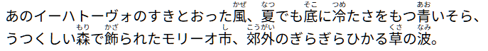
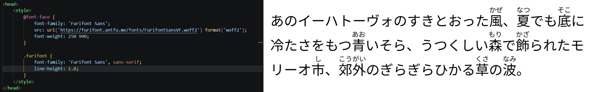
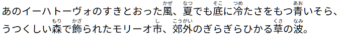

# あえて `ruby` 要素を使わずにふりがなを表示してみる

本稿は[「あえての素のWeb Advent Calendar 2026」](https://qiita.com/advent-calendar/2026/web-pure) 8 日目の記事となる予定です。

## ふりがなと Web アクセシビリティの関係

Web が社会の基盤となって久しい時が経ちました。故に現代の Web は一部の人の為の物ではなく、ありとあらゆる人々を包摂する存在でなければなりません。

民間企業でも Web アクセシビリティを確保すること（環境の整備）は努力義務とされており、規格として [JIS X 8341-3:2016](https://waic.jp/docs/jis2016/understanding/201604/)[^1] が定められています。この規格は [Web Content Accessibility Guidelines（WCAG）2.0](https://waic.jp/translations/WCAG20/Overview.html) の一致規格となっており、A（最低）～AAA（最高）の 3 段階で適合レベルが設定されています。

[^1]: 正式には「高齢者・障害者等配慮設計指針－情報通信における機器，ソフトウェア及びサービス－第3部：ウェブコンテンツ」

WCAG 2.0 の[達成基準 3.1.6: 発音（レベル AAA）](https://waic.jp/translations/UNDERSTANDING-WCAG20/meaning-pronunciation.html) は以下のような内容となっています。

> **3.1.6 発音: 文脈において、発音が分からないと単語の意味が不明瞭になる場合、その単語の明確な発音を特定するメカニズムが利用できる。 (レベル AAA)**  
> 適切な発音を文の文脈から決定できる場合は、何も必要とされない。それができない場合は、適切な発音を決定するための何らかの仕組みが必要になる。さらに、一部の言語は、特定の文字が異なる方法で発音されることがある。例えば、日本語では、複数の発音を持つ漢字のような文字がある。スクリーンリーダーは、発音に関する情報がないと、文字を間違って話すことがある。間違って読むと、コンテンツは利用者にとって意味をなさなくなるだろう。

この基準の達成方法に[ふりがな（ルビ）](https://ja.wikipedia.org/wiki/%E6%8C%AF%E3%82%8A%E4%BB%AE%E5%90%8D)が含まれているというわけです。AAA レベルなので達成必須ではないですが、視覚や読字に障害がある方だけでなく、「やさしい日本語」を必要とする子どもや日本語に不慣れな方にとっても、ふりがなは重要なアクセシビリティ要素です。

## `ruby` 要素でふりがなを表示する

WCAG 2.0 で案内されている解決策の 1 つが [`ruby` 要素](https://www.w3.org/TR/ruby/) の使用です。地方自治体の Web サイトなどで見かける[かな棒くん](https://www.kanabo.com/product/?furigana=on)や、[青空文庫](https://www.aozora.gr.jp/) の XHTML 版も `ruby` 要素でふりがなを表示しています。

現在でこそ全ての主要ブラウザで実装されていますが、1998 年に提案された仕様が W3C 標準に取り込まれたのは 2001 年になってからでした。Microsoft はこれに先行して 1999 年のうちに [Internet Explorer 5.0 で実装](https://www.unicode.org/iuc/iuc16/c6/paper.pdf)しています。[第一次ブラウザ戦争](https://ja.wikipedia.org/wiki/%E3%83%96%E3%83%A9%E3%82%A6%E3%82%B6%E6%88%A6%E4%BA%89)の頃の出来事です。

基本的な文法は `<ruby></ruby>` で対象を囲い、その内側に `<rt></rt>` でふりがなを追加するというものです。[^2]

```html
あのイーハトーヴォのすきとおった<ruby>風<rt>かぜ</rt></ruby>、<ruby>夏<rt>なつ</rt></ruby>でも<ruby>底<rt>そこ</rt></ruby>に<ruby>冷<rt>つめ</rt></ruby>たさをもつ<ruby>青<rt>あお</rt></ruby>いそら、うつくしい<ruby>森<rt>もり</rt></ruby>で<ruby>飾<rt>かざ</rt></ruby>られたモリーオ<ruby>市<rt>し</rt></ruby>、<ruby>郊外<rt>こうがい</rt></ruby>のぎらぎらひかる<ruby>草<rt>くさ</rt></ruby>の<ruby>波<rt>なみ</rt></ruby>。
```

[^2]: [宮沢賢治 ポラーノの広場](https://www.aozora.gr.jp/cards/000081/files/1935_19925.html)より

ソースで見ると何のこっちゃという感じですが、ブラウザはこのようにレンダリングしてくれます。W3C の要件が [JIS X 4051:1995](https://ja.wikipedia.org/wiki/JIS_X_4051) [^3] を参考にしているだけあって、印刷物の組版と比較しても違和感のないレイアウトになっていますね。

[^3]: 正式には「日本語文書の組版方法」



しかし、一部のスクリーンリーダーはこれらの要素を適切に処理せず、対象文字とふりがなの両方を読み上げてしまいます。[^4] せっかくのアクセシビリティを向上させるための配慮がアクセシビリティを下げてしまうようでは本末転倒です。

[^4]: 例：Microsoft Edge の「音声で読み上げる」機能

## Furifont でふりがなを表示する

[Furifont](https://furifont.antfu.me/) は OpenType の仕組みを活用してプレーンテキストでふりがなを表示するフリーフォントです。[Anthony Fu](https://github.com/antfu) 氏の公開する OSS で、フォント本体は [SIL Open Font License](https://ja.wikipedia.org/wiki/SIL_Open_Font_License) 、ツール部分は MIT となっています。Web フォントとしても提供されているので、CSS でフォントを指定するだけでふりがなを表示できてしまいます。

```html
<html>

<head>
    <style>
        @font-face {
            font-family: 'Furifont Sans';
            src: url('https://furifont.antfu.me/fonts/FurifontSansVF.woff2') format('woff2');
            font-weight: 250 900;
        }

        .furifont {
            font-family: 'Furifont Sans', sans-serif;
            line-height: 1.8;
        }
    </style>
</head>

<body>
    <p class="furifont">あのイーハトーヴォのすきとおった風、夏でも底に冷たさをもつ青いそら、うつくしい森で飾られたモリーオ市、郊外のぎらぎらひかる草の波。</p>
</body>

</html>
```



単語にふりがなを振った状態を[リガチャー（合字）](https://ja.wikipedia.org/wiki/%E5%90%88%E5%AD%97)用の[グリフ（字体）](https://ja.wikipedia.org/wiki/%E5%AD%97%E4%BD%93)として登録しており、[レイアウトテーブル](https://qiita.com/496_/items/02f2d63fe4bd5603e4dc)内の情報を元に「読み方」を適用します。読み方が複数ある言葉はもっとも一般的な読み方が選択されたり、読みが確定しない単語にはふりがなが表示されなかったりしますが、[異体字セレクタ](https://ja.wikipedia.org/wiki/%E7%95%B0%E4%BD%93%E5%AD%97%E3%82%BB%E3%83%AC%E3%82%AF%E3%82%BF)で手動選択できるので安心です。

```html
<p class="furifont">あのイーハトーヴォのすきとおった風、夏でも底に冷&#xE01E2;たさをもつ青いそら、うつくしい森で飾られたモリーオ市、郊外のぎらぎらひかる草の波。</p>
```



Furifont でふりがなを表示していても、HTML としてはプレーンテキストなので二重読み上げ問題は発生しません。[^5]

[^5]: 実際、Microsoft Edge の「音声で読み上げる」機能でも二重読み上げにはなりませんでした。

## まとめ

Furifont は技術的な面白さと実用性が同居した素晴らしいプロジェクトですが、`ruby` 要素に期待されていた「正しい発音をスクリーンリーダーに伝達する」という役割は果たせません。開発意図としても日本語学習者をターゲットとしているようなので、どちらかといえば「子どもや日本語に不慣れな方」に向けた解決策ということになるでしょうか。

一方、`ruby` 要素の二重読み上げ問題については、[日本 DAISY コンソーシアムがブラウザベンダらに改善を求めて](https://www.publickey1.jp/blog/21/webdaisywhatwgw3c.html)から 5 年経っての現状ですから、なんとももどかしいですね。早期の解決を望みたいところです。

## 参考リンク

* [`<ruby>` ルビ注釈要素 - HTML | MDN](https://developer.mozilla.org/ja/docs/Web/HTML/Reference/Elements/ruby)
* [Webのルビ仕様にはアクセシビリティを阻害している面がある。「日本DAISYコンソーシアム」が改善を求めてブラウザベンダ、WHATWG、W3Cらに公開書簡 － Publickey](https://www.publickey1.jp/blog/21/webdaisywhatwgw3c.html)
* [Furifont：ふりがなを表示するフォント](https://furifont.antfu.me/)
* [antfu/furifont: A Japanese font that shows furigana by itself.](https://github.com/antfu/furifont)
* [漢字の上にふりがなを表示する日本語フォント「Furifont」オープンライセンスで公開 | gihyo.jp](https://gihyo.jp/article/2026/10/furifont)
* OpenTypeの仕様入門：[前編](https://qiita.com/496_/items/f6efb650dcf7e9d2dfe4) / [中編](https://qiita.com/496_/items/4f8327fe741cf0c87736) / [後編](https://qiita.com/496_/items/02f2d63fe4bd5603e4dc)
